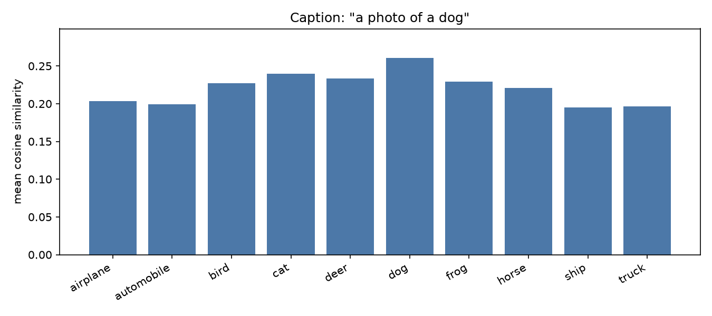
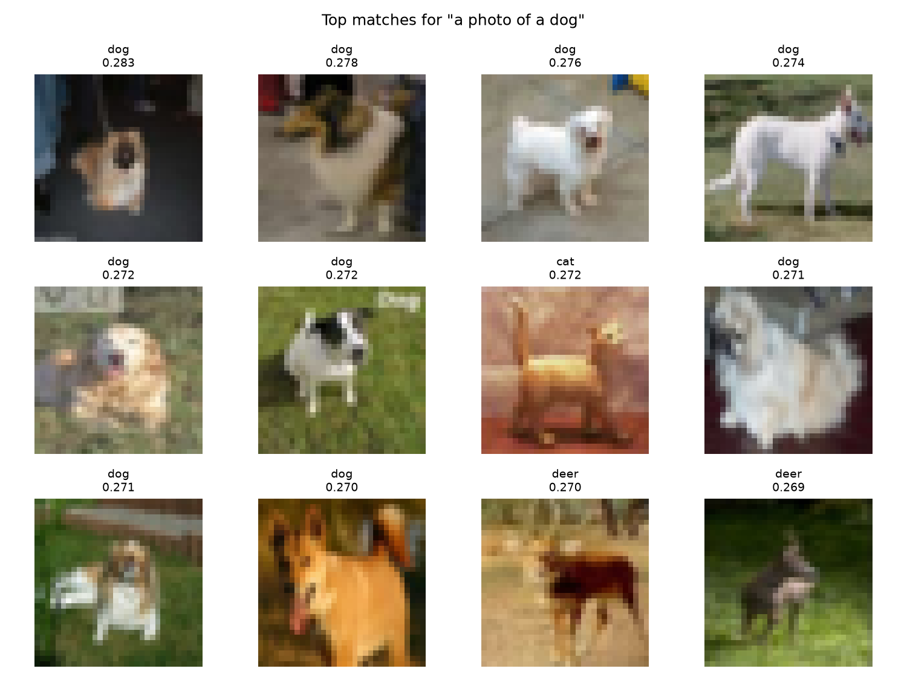
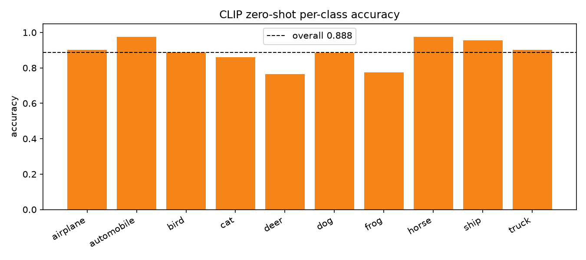
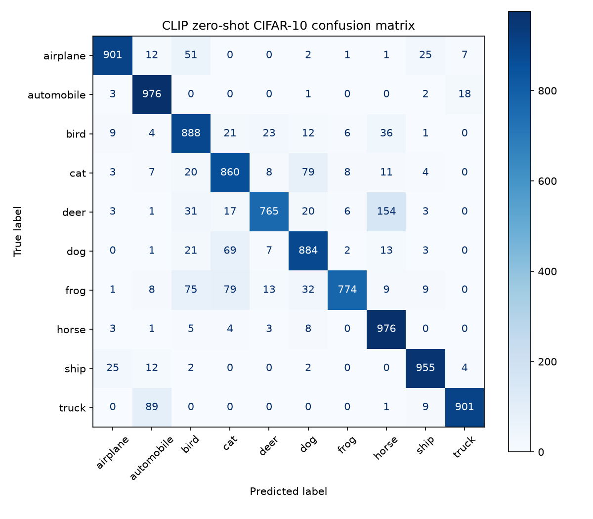

# DATA 266 — Homework 11

Sneha Singh  
SID4 = 0670 | SEED = 670 | SLICE = 670 | HP_ID = 4 | CLS_A = 0 | CLS_B = 5

Notebook: `clip_cifar.ipynb`. Model: `openai/clip-vit-base-patch32`. Dataset: CIFAR-10.

HP_ID is reported only.

## 1. Setup

| Item | Value |
|------|-------|
| Model | `openai/clip-vit-base-patch32` (~151M params) |
| Dataset | CIFAR-10 (train for Part A, test for Part B) |
| Caption | `a photo of a dog` |
| Part A sample | 100 images per class (1,000 total), SEED=670 |
| Zero-shot prompts | `a photo of a {class}` for all 10 classes |
| Device | MPS |
| Batch size | 64 |

I load CLIP with the matching processor. Text and image embeddings are L2-normalized, then compared with cosine similarity (dot product of unit vectors).

## 2. Caption–image similarity

I scored the caption against 1,000 CIFAR-10 train images (100 per class).

| Class | Mean similarity |
|-------|----------------:|
| airplane | 0.204 |
| automobile | 0.200 |
| bird | 0.227 |
| cat | 0.240 |
| deer | 0.234 |
| dog | **0.260** |
| frog | 0.229 |
| horse | 0.221 |
| ship | 0.195 |
| truck | 0.196 |

Highest mean class: **dog** (0.260).

Dog ranks first, then cat and other animals. Vehicles sit at the bottom — the expected order for a dog caption.

The top-12 gallery is mostly dogs, with a few other animals that still look somewhat dog-like at 32×32.

## 3. Zero-shot CIFAR-10 classification

I embedded all 10 class prompts and classified every CIFAR-10 test image (n=10,000) by the highest cosine similarity. Overall accuracy: **0.888**.

| Class | Accuracy |
|-------|---------:|
| airplane | 0.901 |
| automobile | 0.976 |
| bird | 0.888 |
| cat | 0.860 |
| deer | 0.765 |
| dog | 0.884 |
| frog | 0.774 |
| horse | 0.976 |
| ship | 0.955 |
| truck | 0.901 |

Automobile and horse are strongest (97.6%). Deer is weakest (76.5%), mostly confused with horse. Cat↔dog and frog↔bird/cat swaps show up too — expected for similar animals at CIFAR resolution.

## Conclusion

CLIP ranked the dog caption highest on dog images with no fine-tuning. Zero-shot CIFAR-10 reached 88.8% accuracy. Errors concentrate on visually similar pairs (deer/horse, cat/dog), matching the confusion matrix.
