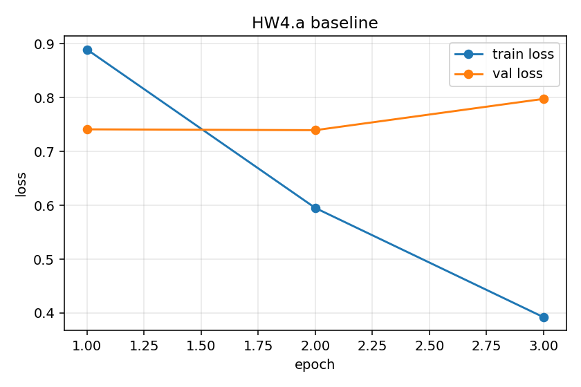
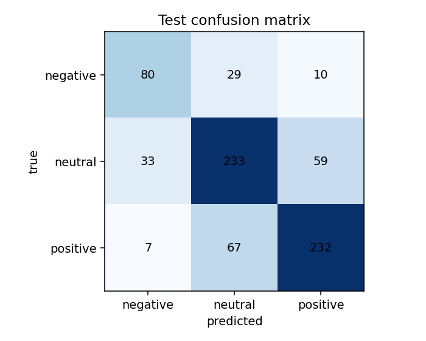
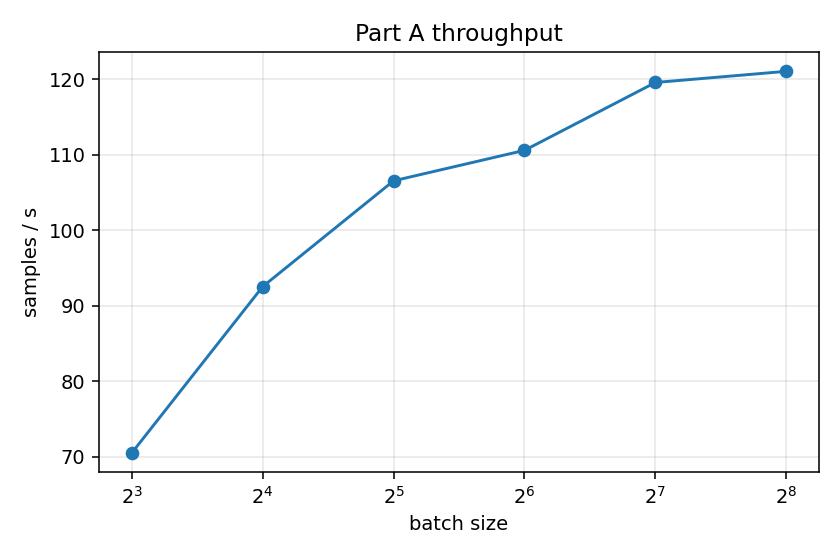
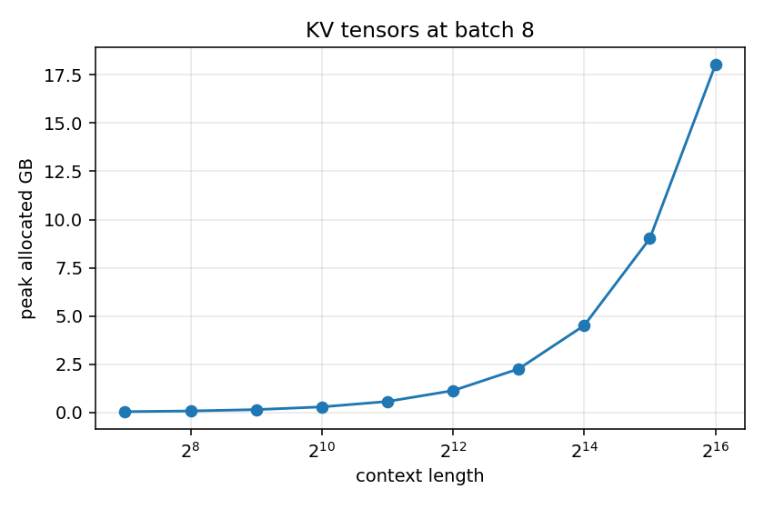

# DATA 266 — Homework 4.5

Sneha Singh  
SID4 = 0670 | SEED = 670 | SLICE = 670 | HP_ID = 4 | CLS_A = 0 | CLS_B = 5

Notebook: `hw4.5.ipynb`. GPU: NVIDIA L4 on Colab Pro. Part C skipped (optional). One GPU.

Same standing parameters as HW1. HP_ID is reported only. There is no second network. Every number below is from the executed Colab notebook and from `RUN_LOG.txt` / `METRICS.md`.

## Setup

| Item | Value |
|------|-------|
| Data | `cardiffnlp/tweet_eval` sentiment, train split only |
| Rows | 670–5669 inclusive (5,000 consecutive) |
| Split | 3,500 / 750 / 750 with SEED 670 |
| Labels in slice | negative 773, neutral 2290, positive 1937 |
| Model | `bert-base-uncased`, BertTokenizer, max length 128 |
| Baseline train | batch 16, AdamW, lr 2e-5, weight decay 0.01, 3 epochs |
| Serving model | `facebook/opt-125m`, 32 new tokens, greedy |
| Device | NVIDIA L4 (Colab Pro) |

I do not use the dataset’s own validation or test splits. The same frozen slice and the same SEED split are used for HW4.a and for every Part A / B run.

## HW4.a — BERT sentiment baseline

I fine-tuned BERT for three epochs. Validation loss was lowest at **epoch 2** (0.7395). Epoch 3 went to 0.7976, so I kept the epoch-2 weights for the test score. Training past that point cost about **38.3 s** (the third epoch).

| Epoch | Train loss | Val loss | Val accuracy | Seconds |
|------:|-----------:|---------:|-------------:|--------:|
| 1 | 0.8892 | 0.7410 | 0.6640 | 37.0 |
| 2 | 0.5950 | 0.7395 | 0.6773 | 37.8 |
| 3 | 0.3922 | 0.7976 | 0.6813 | 38.3 |

Peak allocated memory for the baseline was **2.48 GB**. Wall-clock training time was **113.1 s**. That is **0.0314 GPU-hours** (113.1 / 3600). Test accuracy at the best validation-loss epoch was **0.7267**.

| Class | Precision | Recall | Support |
|-------|----------:|-------:|--------:|
| negative | 0.6667 | 0.6723 | 119 |
| neutral | 0.7082 | 0.7169 | 325 |
| positive | 0.7708 | 0.7582 | 306 |

Worst class: **negative**. That class has only 119 test examples (and 773 in the full 5,000-row slice), so the lower recall is partly a support problem, not only a model bug.

Five negative tweets the model called neutral:

1. *"Sophos is the Lamest Virus Ever..."* — insult is there, but the rest reads like a headline, so the model stayed neutral.
2. *"Because she's Caitlyn Jenner. Come to FL sistah where you can run someone over with no consequences."* — the negativity is implied and sarcastic; there is no clear negative word for the classifier to latch onto.
3. *"Tonight may be the night when I finally expose myself to the Gilmore Girls hysteria"* — ironic tone, not a clear complaint.
4. *"Monday was Gucci but then it went downhill"* — the tweet flips mid-sentence; the model missed the turn.
5. *"Hahaha 2nd place in Miss USA was Miss Texas..."* — sarcasm wrapped around a joke; it does not look like a plain negative tweet.

I saved one checkpoint only: `checkpoints/bert_baseline/`, after loading the best validation-loss state. Reload on three held-out sentences gave positive / negative / neutral in that order, which matches the labels I intended.

## Serving — HF pipeline vs vLLM

Same 32 prompts, `facebook/opt-125m`, float16, 32 new tokens. Per-request latency for a batched vLLM call is the wait for that whole batch, because the requests return together.

| Setup | Tokens/s | p50 (ms) | p95 (ms) |
|-------|---------:|---------:|---------:|
| HF pipeline, batch 1 | 115.7 | 269.3 | 280.8 |
| vLLM batch 1 (HW4.a) | 97.8 | 319.1 | 328.4 |
| vLLM batch 8 (HW4.a) | 627.8 | 349.2 | 354.9 |
| vLLM batch 32 (HW4.a) | 2273.5 | 383.7 | 386.5 |
| vLLM batch 1 (HW4.5) | 97.9 | 320.4 | 325.3 |
| vLLM batch 8 (HW4.5) | 622.9 | 348.8 | 355.4 |
| vLLM batch 32 (HW4.5) | 2354.5 | 368.4 | 378.6 |

On this L4 run, vLLM at batch 1 was a little slower than the HF pipeline on both tokens/s and p50. From batch 8 onward, tokens/s rose a lot while p50 stayed above the HF batch-1 baseline. So throughput can improve while one person waits longer. For an interactive app I care about **p50**, not tokens/s. Tokens/s matters when many requests share the GPU.

## Part A — batch scaling

Same fine-tune settings. I doubled the batch until one forward/backward on exactly that many length-128 rows ran out of memory. Each size that fit also got one pass over the 3,500 training rows.

| Batch | Samples/s | Peak GB | Seconds / epoch |
|------:|----------:|--------:|----------------:|
| 8 | 70.5 | 2.09 | 49.7 |
| 16 | 92.5 | 2.49 | 37.8 |
| 32 | 106.5 | 3.76 | 32.9 |
| 64 | 110.6 | 6.15 | 31.7 |
| 128 | 119.6 | 11.00 | 29.3 |
| 256 | 121.0 | 20.65 | 28.9 |
| 512 | OOM | — | — |

Largest batch that ran: **256**. Fastest batch: **256** at 121.0 samples/s. Throughput was already within 5% of that peak by batch **128** (119.6 samples/s), so the useful gains stop before the memory wall. Batch 512 is the first OOM.

I only had one GPU, so I cannot measure a max-batch ratio across two cards. In general that ratio is not equal to the VRAM ratio, because weights, Adam state, and CUDA context are a fixed cost, and the ladder only tests powers of two.

## Part B — memory techniques

Table HW4.5.1. Max batch for the baseline row is Part A’s max batch (256). Accumulation’s “max batch” is the effective batch 128 with physical batch 8.

| Technique | Max batch | Throughput (samp/s) | Peak memory (GB) | Eval accuracy |
|-----------|----------:|--------------------:|-----------------:|--------------:|
| Baseline (HW4 settings) | 256 | 92.8 | 2.48 | 0.7267 |
| Mixed precision | 256 | 189.3 | 2.26 | 0.7040 |
| Gradient checkpointing | 1024 | 70.7 | 2.09 | 0.7267 |
| Gradient accumulation | 128 (physical 8) | 99.5 | 2.32 | 0.6520 |
| 8-bit optimiser | 256 | 99.3 | 1.90 | 0.7187 |
| Best combination | 256 | 222.0 | 1.64 | 0.7160 |

At batch 16, **8-bit AdamW** saved the most memory without slowing the run (1.90 GB vs 2.48 GB, and samples/s went up slightly), so that is what I would apply first. **Mixed precision** also saved memory and roughly doubled throughput. **Gradient checkpointing** only saved about 0.39 GB at batch 16 and cut samples/s from 92.8 to 70.7, so on a 32 GB card I would not bother with it for this BERT fine-tune. It did raise the max batch to 1024, which matters only if I am chasing the memory wall.

The combination the ranking rule picked was **AMP + 8-bit AdamW** (no checkpointing): 222.0 samples/s, 1.64 GB, test accuracy 0.7160.

## Part C

Part C skipped (optional).

## Part D — KV cache vs context

I allocated the key and value tensors for `facebook/opt-125m` at batch 8. That is the tensor size, not a vLLM serve. The serve numbers are in the table above; the HW4.5 pass matched the HW4.a pass closely.

| Context | Peak allocated GB |
|--------:|------------------:|
| 128 | 0.05 |
| 256 | 0.09 |
| 512 | 0.16 |
| 1024 | 0.30 |
| 2048 | 0.58 |
| 4096 | 1.14 |
| 8192 | 2.27 |
| 16384 | 4.52 |
| 32768 | 9.02 |
| 65536 | 18.02 |

On this L4, every length in that ladder still fit. OPT-125m’s KV tensors are small (12 layers, 12 heads, head dim 64), so the allocation wall is far past the model’s usual 2048 position limit.

## Part E — summary

GPU-hours for one full fine-tune: **113.1 / 3600 = 0.0314**.

The configuration I would keep is **Best combination (AMP + 8-bit AdamW)**: peak **1.64 GB**, **222.0** samples/s, wall-clock **47.3 s**, test accuracy **0.7160** (within 1.5 points of the baseline 0.7267). This is the HW4.5 summary. It is not an HW5 baseline.

## Conclusion

On the L4, BERT-base at batch 16 is not memory-bound (2.48 GB). Throughput stops improving much by batch 128, and the card OOMs at 512. Mixed precision and 8-bit AdamW are the useful changes for this workload. Checkpointing is the wrong first tool here unless I need a much larger batch. On the serving side, larger vLLM batches raise tokens/s while p50 gets worse than the HF batch-1 baseline, so an interactive demo should watch latency, not only throughput.
