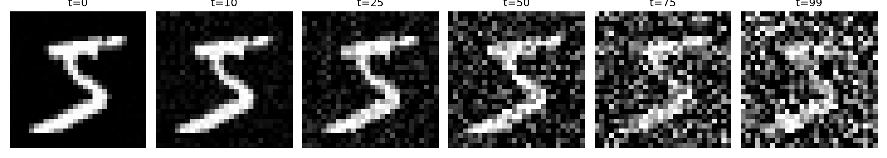
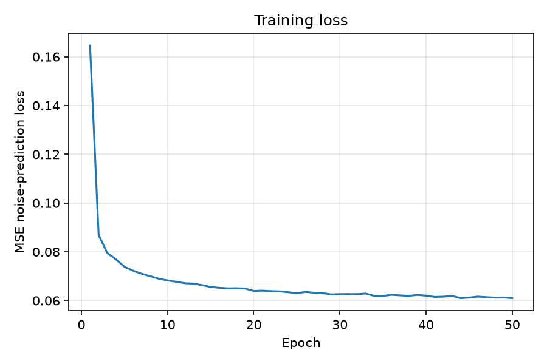
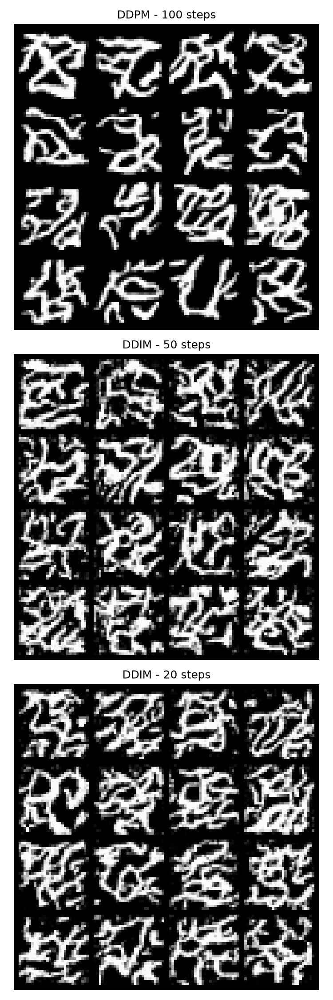

# DATA 266 — Homework 8

Sneha Singh  
SID4 = 0670 | SEED = 670 | SLICE = 670 | HP_ID = 4 | CLS_A = 0 | CLS_B = 5

Notebook: `mini_diffusion.ipynb`. Dataset: MNIST.

Same SID/SEED as the earlier homework. I did not train a second HP_ID network. The trained model is one timestep-conditioned CNN; DDPM and DDIM are two sampling procedures applied to that same model.

## 1. Forward diffusion

I used `T = 100` diffusion steps and a linear β schedule from `0.0001` to `0.02`. The closed-form forward process was:

\[
x_t = \sqrt{\bar{\alpha}_t}x_0 + \sqrt{1-\bar{\alpha}_t}\epsilon,
\qquad \epsilon \sim \mathcal{N}(0,I).
\]

I showed one MNIST image at several timesteps. At the first few steps the digit is still clear. Later it is mostly noise. That is the fixed forward process; there is no learned model in this part.

## 2. CNN and training

I used a small CNN with five convolutional layers, ReLU activations, timestep conditioning, and one output channel. The output has the same shape as the input image. The timestep embedding is added to the convolution features so the network knows how much noise is present.

The model has **97,537 parameters**, and the output check printed `torch.Size([2, 1, 28, 28])`.

For every batch I sampled a random timestep, made `x_t`, and trained the network to predict the exact Gaussian noise used to make it. The loss is mean squared error between the true noise and the predicted noise. Batch size was `128`, the learning rate was `1e-3`, and I trained for 50 epochs on MPS.

The loss went from **0.164547** in epoch 1 to **0.061000** in epoch 50. It dropped quickly at the beginning and then flattened around 0.061.

## 3. DDPM sampling

I started from Gaussian noise and used the learned reverse process for all 100 steps. At each step the model predicts the noise, I compute the reverse mean, and I add posterior noise except at the final step.

The DDPM samples are not clean digits on this run. They look more like loose digit-shaped strokes. The model learned some image structure, but it did not learn enough to generate recognizable MNIST samples consistently.

## 4. DDIM sampling

I kept the same trained CNN and changed only the sampling procedure. DDIM uses a shorter timestep schedule and jumps over some of the 100 training steps. I used 50 steps and 20 steps with `eta = 0`, so a fixed starting noise tensor gives a deterministic result.

The DDIM samples are also noisy. The 50-step and 20-step grids do not show a clear quality improvement over the 100-step DDPM grid. With this small CNN and one 50-epoch run, reducing the number of denoising steps did not produce clean digits.

## 5. Comparison

| Sampler | Reverse steps | What I saw |
|---------|---------------:|------------|
| DDPM | 100 | Loose digit-like strokes; stochastic sampling |
| DDIM | 50 | Faster shorter chain, but still noisy |
| DDIM | 20 | Shortest chain; samples still noisy and not clearly better |

DDIM changes the sampling path, not the trained noise-prediction model. That is why all three results have similar limitations here. I am not claiming that DDIM improved the output just because it used fewer steps.

## Conclusion

The forward process and training loss behaved as expected: the image became noise over time, and the noise-prediction loss decreased from 0.164547 to 0.061000. The reverse samples were the weak part of this run. The CNN was small, and the 50-epoch training run was not enough to produce clean digits. DDIM demonstrated the step-skipping idea, but its 50-step and 20-step outputs were still noisy.
